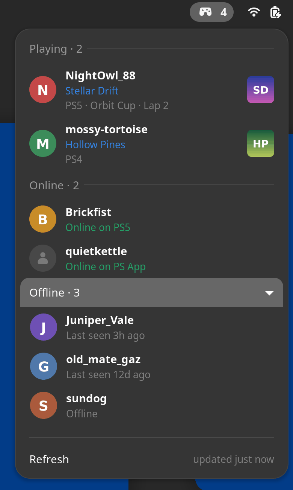

# psn-friends

See which of your PlayStation Network friends are online and what they're
playing, from the GNOME top bar or your terminal.



<sub>Screenshot uses made-up sample friends.</sub>

- **Top-bar button** with a count of friends online. Click it for who's playing
  what (with game art and in-game status when available), who's online, and when
  offline friends were last seen.
- **Command-line tool** that works on its own, in any terminal, on any Linux.
- Refreshes every minute. Your sign-in renews itself for about two months at a
  time.

## Requirements

- Linux, x86_64 or arm64
- GNOME Shell 46–50 for the top-bar button (the CLI works anywhere)
- A PlayStation Network account

## Install

### From a release (no Rust needed)

Download the `.tar.gz` for your machine from the
[latest release](https://github.com/danvaneijck/psn-friends/releases/latest), then:

```sh
tar xzf psn-friends-*-linux.tar.gz
cd psn-friends-*-linux
./install.sh
```

### From source

With [Rust](https://rustup.rs) installed:

```sh
git clone https://github.com/danvaneijck/psn-friends
cd psn-friends
./install.sh
```

Either way, `install.sh` puts the `psn-friends` command in `~/.local/bin`
and installs and enables the GNOME extension. It doesn't need root.

Just want the CLI? `cargo install --git https://github.com/danvaneijck/psn-friends`

## Sign in

1. Sign in at [playstation.com](https://www.playstation.com) in your browser.
2. In the same browser, open
   <https://ca.account.sony.com/api/v1/ssocookie>. You'll see something like
   `{"npsso":"Ab12…"}`.
3. Run `psn-friends login` and paste either the whole line or just the
   64-character `npsso` value. Input is hidden.

`login` swaps that token for its own sign-in, saved in
`~/.config/psn-friends/tokens.json` (readable only by you), and prints your
friends to confirm it worked.

> [!WARNING]
> The NPSSO token gives access to your PSN account. Don't paste it anywhere
> except `psn-friends login`, and don't share it. Signing out of
> playstation.com in that browser invalidates it.

**Log out and back in** to load the extension. GNOME on Wayland only picks up
new extensions at login.

About two months later the sign-in expires. The button shows **!** and "Sign in
to PSN". Repeat the steps above with a fresh token.

## Command line

```text
$ psn-friends
2 of 24 friends online
▶ NightOwl_88     Stellar Drift PS5 — Orbit Cup · Lap 2
● Brickfist       online PS5
(--all to include offline friends)
```

| Command | What it does |
| --- | --- |
| `psn-friends` | Friends who are online or playing |
| `psn-friends -a` | Everyone, including when offline friends were last seen |
| `psn-friends status --json` | Machine-readable snapshot (what the extension uses) |
| `psn-friends login` | Connect your PSN account |
| `psn-friends logout` | Delete the saved sign-in |

Exit codes: `0` success, `1` error, `2` sign-in needed.

## How it works

The CLI does all the PSN work. It refreshes the sign-in when needed, fetches
your friends list, their presence and profiles in a few batched requests, and
caches avatars and game art on disk. The extension runs
`psn-friends status --json` every 60 seconds, and when you open the menu if the
data is over 30 seconds old. It never touches the network itself, so a slow or
failing PSN can't freeze your desktop.

| Path | Contents |
| --- | --- |
| `~/.config/psn-friends/tokens.json` | Access and refresh tokens (mode 600) |
| `~/.cache/psn-friends/profiles.json` | Friends' names and avatar URLs, refetched daily |
| `~/.cache/psn-friends/img/` | Downloaded avatars and game art |

It talks only to Sony's servers. Nothing is sent anywhere else.

## Troubleshooting

- **No button in the top bar:** log out and back in, then check
  `gnome-extensions info psn-friends@danvaneijck.github.io`. It should say
  `State: ACTIVE`.
- **"Can't find the psn-friends command":** the extension looks in
  `~/.local/bin`, `~/.cargo/bin` and the shell's `PATH`.
- **A friend always shows Offline:** they've hidden their online status in
  their PSN privacy settings. Many people also hide their last-online time.
- **No game art:** PSN doesn't send art for every game. You'll see a
  placeholder instead.
- **Anything else:** run `psn-friends` in a terminal to see the full error, or
  watch the extension's log with `journalctl --user -f -o cat /usr/bin/gnome-shell`.

## Uninstall

```sh
./install.sh --uninstall
rm -rf ~/.config/psn-friends ~/.cache/psn-friends   # sign-in and cache
```

## Development

```sh
cargo test
cargo clippy --all-targets
```

The extension lives in `extension/psn-friends@danvaneijck.github.io/`.
After editing it, run `./install.sh` and log out and back in. Releases are
built by GitHub Actions when a `v*` tag is pushed.

## Notes

This uses the same unofficial API as the PlayStation app, documented by
[psn-api](https://github.com/achievements-app/psn-api) and
[PSNAWP](https://github.com/isFakeAccount/psnawp). Sony could change it at any
time. A one-minute refresh is far below its rate limits.

Not affiliated with or endorsed by Sony Interactive Entertainment.
"PlayStation" and "PSN" are trademarks of Sony Interactive Entertainment Inc.

## License

[MIT](LICENSE)
